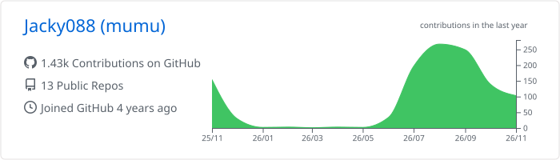
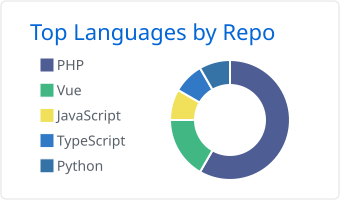
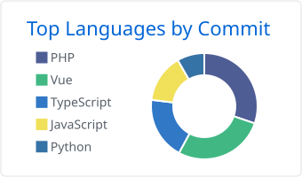
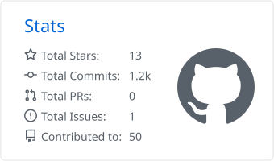
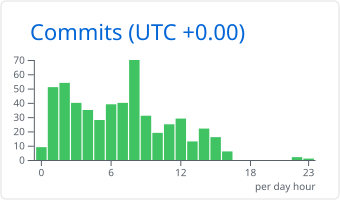

  

  

  
  
  

 

## ⚡ 关于我

> **代码即艺术，效率至上，极简唯美。**

- 🔭 **专注方向：** 构建高性能应用与开源工具，深耕边缘计算与前端体验
- 🌱 **正在探索：** `Edge Computing` · `Workers` · `全栈边缘部署`
- 💡 **开源理念：** 追求轻量、极致性能与优雅的交互细节

 

## 🛡️ 技术栈

  <a href="https://skillicons.dev">
    <picture>
      <source media="(prefers-color-scheme: dark)" srcset="https://skillicons.dev/icons?i=py,js,ts,go,rust,react,nextjs,vue,docker,k8s,git,linux,vscode,neovim&theme=dark&perline=7" />
      <source media="(prefers-color-scheme: light)" srcset="https://skillicons.dev/icons?i=py,js,ts,go,rust,react,nextjs,vue,docker,k8s,git,linux,vscode,neovim&theme=light&perline=7" />
      
    </picture>
  </a>

 

## 🚀 精选项目

<table width="100%">
  <tr>
    <td width="33.3%" valign="top">
      <h3 align="center">
        <a href="https://github.com/Jacky088/Daily-Hot">🔥 Daily-Hot</a>
      </h3>
      

        
      

      
一站式热榜聚合面板

      

        <code>HTML</code> · <code>CSS</code> · <code>JS</code>
      

    </td>
    <td width="33.3%" valign="top">
      <h3 align="center">
        <a href="https://github.com/Jacky088/Edgeone-Imgbed">🖼️ Edgeone-Imgbed</a>
      </h3>
      

        
      

      
基于边缘计算的高性能图床

      

        <code>Workers</code> · <code>Edge</code>
      

    </td>
    <td width="33.3%" valign="top">
      <h3 align="center">
        <a href="https://github.com/Jacky088/Edgeone-ShortURL">🔗 Edgeone-ShortURL</a>
      </h3>
      

        
      

      
边缘计算的短链接跳转服务

      

        <code>Workers</code> · <code>Edge</code>
      

    </td>
  </tr>
  <tr>
    <td width="33.3%" valign="top">
      <h3 align="center">
        <a href="https://github.com/Jacky088/homepage">🌐 Homepage</a>
      </h3>
      

        
      

      
个人简约风格主页

      

        <code>Vue</code> · <code>HTML</code>
      

    </td>
    <td width="33.3%" valign="top">
      <h3 align="center">
        <a href="https://github.com/Jacky088/apps_exhibition">📱 Apps-Exhibition</a>
      </h3>
      

        
      

      
APP 应用作品展示 WP 插件

      

        <code>React</code> · <code>Web</code>
      

    </td>
    <td width="33.3%" valign="top">
      <h3 align="center">
        <a href="https://github.com/Jacky088/goods_exhibition">🛍️ Goods-Exhibition</a>
      </h3>
      

        
      

      
精品好物与周边橱窗 WP 插件

      

        <code>Vue</code> · <code>Tailwind</code>
      

    </td>
  </tr>
</table>

 

<b>📂 更多开源项目与归档（WordPress 插件系列）</b>

 

| 项目名称 | 简介 |
| :--- | :--- |
| **[Elegant-TOC](https://github.com/Jacky088/Elegant-TOC)** | 优雅的文章目录与大纲悬浮导航 WP 插件 |
| **[Photo-Wall](https://github.com/Jacky088/photo-wall)** | 响应式个人摄影与精美图片墙 WP 插件 |
| **[Flavor-Like](https://github.com/Jacky088/flavor-like)** | 现代化的轻量级点赞与互动 WP 组件 |
| **[Post-Views](https://github.com/Jacky088/post-views)** | 高性能博客文章浏览量统计与计数服务 WP 组件 |
| **[External-Link](https://github.com/Jacky088/External-Link)** | 功能完善的外链安全跳转 WP 插件 |

 

## 📊 GitHub 数据

  

  
  

  
  

  

<!-- 🐍 贪吃蛇动画：需要先在 Jacky088/Jacky088 仓库配置 GitHub Action 生成 SVG 后再取消注释

  

-->

  

